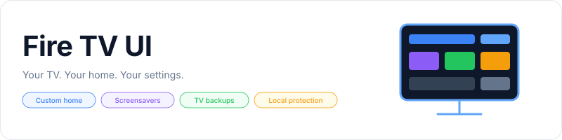
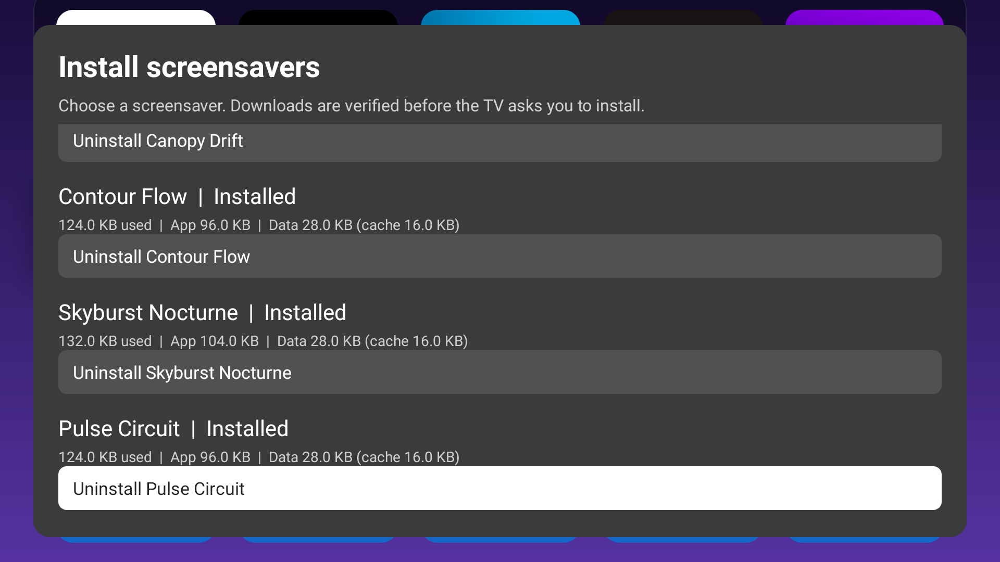

<p align="center">
    <picture>
        <source media="(prefers-color-scheme: dark)" srcset="art/banner-dark.svg">
        <source media="(prefers-color-scheme: light)" srcset="art/banner-light.svg">
        
    </picture>
</p>

<p align="center">A customizable home screen for Fire TV, with screensavers, persistent backups, local device protection, and every feature included.</p>

<p align="center">
    <a href="#building"></a>
    <a href="LICENSE"></a>
</p>

## Table of Contents

- [Requirements](#requirements)
- [Installation](#installation)
- [Quick Start](#quick-start)
- [Features](#features)
- [Configuration](#configuration)
- [Building](#building)
- [Testing](#testing)
- [Documentation](#documentation)
- [Screensaver Skill](#screensaver-skill)
- [Screenshots](#screenshots)
- [License](#license)

## Requirements

- Fire TV or Android TV running Android 8.1 / API 27 or newer.
- ADB access for installation and the one-time screensaver permission grant.
- Python 3.10+, JDK 21, Android SDK platform 36, and build-tools 36.0.0 to build locally.

## Installation

This repository and its APK are private. Users with repository access can install the signed APK from the private releases, or build it locally. Physical Fire TV, Android TV, and Google TV checks are still welcome; see the [device verification matrix](docs/verification.md).

The [Fire TV Toolkit](https://github.com/jeremykenedy/fire-tv-toolkit) can install a local signed APK and its published checksum:

```bash
firetv-ui --install --apk=/path/to/fire-tv-ui-1.0.1.apk --sha256=PUBLISHED_SHA256
```

For a local build, run `python3 scripts/build.py`, then install it and grant screensaver, backup, storage, and package-install access:

```bash
python3 scripts/install.py --serial YOUR_TV_IP:5555
```

Fire TV UI has its own package identity. It can be installed alongside an existing launcher. Subsequent updates must use the same signing key; `adb install -r` keeps Fire TV UI's settings.

For wireless ADB, Home-button setup, and transferring settings from an existing launcher, see [Installation and updates](docs/installation.md).

## Quick Start

Open **Fire TV UI**, accept the accessibility disclosure if you want remote shortcuts, and use the preferences icon in the top bar to open Settings.

Choose **Settings > Screensavers** to select an installed screensaver. Each row has a sample image, installed storage usage, a circular selector, and a **Preview it** button. The top controls open the current screensaver's options, system timers, installation catalog, and memory usage. Previewing another app restores your prior selection afterward.

Choose **Startup and protection** in Settings to enable or disable Fire TV UI as the startup and Home app, protect selected settings from reversion, or block Amazon update traffic locally. Streaming, weather, CDNs, and screensaver downloads remain available. No analytics, tracking, rating, or project prompts are included.

## Features

- Custom home layout, favorites, folders, app ordering, visibility, and per-app icons.
- Light and dark themes, gradients, images, image URLs, slideshows, and video wallpapers.
- Weather, clocks, calendar, year progress, RSS, podcasts, search, app shortcuts, and other widgets.
- Icon packs, featured cards, Watch Next, and channel management.
- Remote shortcuts, launcher clock screensaver, and backup and restore.
- A near-full-screen screensaver card with sample images, per-app storage usage, individual previews, and access to installed apps' settings.
- Sleep and screensaver timers in minutes, a deep sleep toggle, and RAM and storage percentage bars.
- Verified on-TV downloads and Android-confirmed removal of the curated screensavers.
- Local protection for Home routing, screensaver selection, enabled state, and timers, including boot and APK-update handling.
- Package-scoped Amazon update blocking, with an optional Appstore block and no remote VPN server.
- Persistent TV Downloads backups, CLI import/export, and a saved simple layout.
- All customization features enabled from the first launch.

## Configuration

| Setting | Behavior |
| --- | --- |
| Screensavers | Select, preview, configure, install, or remove screensavers; manage timers and memory. |
| Theme Mode | Choose wallpapers, gradients, icon packs, and text contrast. |
| Appearance | Configure widgets, status bar, favorites, cards, and the launcher clock screensaver. |
| Controls | Configure remote actions and app rows. |
| Backup/Restore | Save or restore the persistent TV backup, or restore a backup sent by the CLI. |
| Startup and protection | Enable or disable startup and Home routing; protect settings and block Amazon updates. |
| About | View the app name, version, credits, and privacy information. |
| Help | Read the feature guide and screensaver setup instructions. |

The launcher clock screensaver starts disabled on a fresh installation so the TV's selected screensaver can run. It remains available in Appearance. Existing clock-screen preferences are preserved on update.

## Building

I'm looking for someone to live-test Fire TV UI on physical **Android TV** and **Google TV** devices. Testing so far covers Fire TV hardware and an Android TV emulator. Home routing, screensavers, timers, and backup behavior still need confirmation on those physical devices.

```bash
python3 scripts/build.py
```

The build verifies its base APK and tool checksums, applies the maintained launcher changes, compiles the added Android code, aligns the APK, signs it, and verifies the signature. Output and SHA-256 files are written to `dist/`.

The signing key is kept outside the repository at `~/.android/keys/fire-tv-ui.jks`. Back up this key and its `.pass` file for future updates. See [Build and source layout](docs/building.md) for unsigned review builds and custom signing keys.

## Testing

```bash
python3 scripts/build.py --unsigned
bash scripts/test.sh
```

The local checks cover screensaver component matching, sorting, duplicate services, missing selections, patch safety, package identity, the settings entry, included features, and removal of purchase messaging from Help. They also verify release hashes, preview provenance, and each new app's settings route on an Android TV emulator. This private repository does not run CI.

Device testing is described in [Verification](docs/verification.md).

## Documentation

- [Installation and updates](docs/installation.md)
- [Build and source layout](docs/building.md)
- [Verification](docs/verification.md)
- [Screensaver previews](docs/screensaver-previews.md)
- [Device controls and backups](docs/device-controls.md)

## Screensaver Skill

[Add a Fire TV screensaver](skills/add-fire-tv-screensaver/SKILL.md) describes how to add new screensaver repos, include a useful image in their APKs, verify them in Fire TV UI, and register them with the Fire TV CLI installer.

Copy `skills/add-fire-tv-screensaver/` into `~/.codex/skills/` to install it locally. Invoke it with `$add-fire-tv-screensaver` and provide the screensaver repo. The CLI registry remains in the separate Fire TV CLI project.

## Screenshots

Captured on Fire TV hardware and an Android TV emulator.

<table>
  <tr>
    <td><br>Home</td>
    <td><br>Settings</td>
    <td><br>TV screensaver</td>
  </tr>
  <tr>
    <td><br>Theme Mode</td>
    <td><br>Appearance</td>
    <td><br>Controls</td>
  </tr>
  <tr>
    <td><br>Backup/Restore</td>
    <td><br>About</td>
    <td><br>Help</td>
  </tr>
  <tr>
    <td><br>System timers</td>
    <td><br>Memory usage</td>
    <td><br>Startup and protection</td>
  </tr>
  <tr>
    <td><br>Install screensavers</td>
    <td><br>More screensavers</td>
    <td><br>TV backups</td>
  </tr>
</table>

## License

This package is open-sourced software licensed under the [MIT license](LICENSE).
