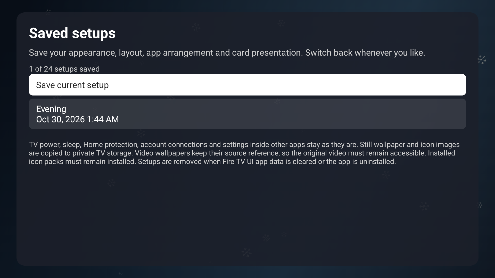

<p align="center">
  <a href="https://github.com/jeremykenedy/fire-tv-ui#gh-light-mode-only"><picture><source media="(max-width: 600px) and (prefers-reduced-motion: reduce)" srcset="art/banner-mobile-still-light.98d256baacad.svg"><source media="(prefers-reduced-motion: reduce)" srcset="art/banner-still-light.cc4cdf921b24.svg"><source media="(max-width: 600px)" srcset="art/banner-mobile-light.7cf87e68fb8d.svg"></picture></a>
  <a href="https://github.com/jeremykenedy/fire-tv-ui#gh-dark-mode-only"><picture><source media="(max-width: 600px) and (prefers-reduced-motion: reduce)" srcset="art/banner-mobile-still-dark.a324d51d0cd9.svg"><source media="(prefers-reduced-motion: reduce)" srcset="art/banner-still-dark.c72c1431c05d.svg"><source media="(max-width: 600px)" srcset="art/banner-mobile-dark.6cfcbd32ad7d.svg"></picture></a>
</p>

<p align="center">A customizable home screen for Fire TV, with screensavers, persistent backups, local device protection, and every feature included.</p>

<p align="center">
  <a href="https://github.com/jeremykenedy/fire-tv-ui/releases"></a>
  <a href="https://github.com/jeremykenedy/fire-tv-ui/releases/latest"></a>
  <a href="https://github.com/jeremykenedy/fire-tv-ui/actions/workflows/ci.yml"></a>
  <a href="LICENSE"></a>
</p>

<p align="center">
  <a href="https://github.com/jeremykenedy"></a>
  <a href="https://github.com/jeremykenedy/fire-tv-ui"></a>
  <a href="https://github.com/sponsors/jeremykenedy"></a>
</p>

## Table of Contents

- [Requirements](#requirements)
- [Installation](#installation)
- [Quick Start](#quick-start)
- [Features](#features)
- [Input icons](#input-icons)
- [Configuration](#configuration)
- [Building](#building)
- [Testing](#testing)
- [Documentation](#documentation)
- [Screensaver Skill](#screensaver-skill)
- [Screenshots](#screenshots)
- [License](#license)

## Requirements

- Fire TV or Android TV running Android 8.1 / API 27 or newer.
- ADB access for installation and the one-time screensaver permission grant.
- Python 3.10+, JDK 21, Android SDK platform 36, and build-tools 36.0.0 to build locally.

## Installation

Install the signed APK from [published releases](https://github.com/jeremykenedy/fire-tv-ui/releases), or build it locally. Fire TV and Android TV have physical checks; see the [device verification matrix](docs/verification.md) for their scope.

Download the signed APK and its checksum from the published release, verify the checksum, then use the repository installer:

```bash
shasum -a 256 -c fire-tv-ui-1.16.0.apk.sha256
adb connect YOUR_TV_IP:5555
python3 scripts/install.py --serial YOUR_TV_IP:5555 --apk /path/to/fire-tv-ui-1.16.0.apk
```

The installer grants the required screensaver, backup, storage and package-install access, restores existing Home routing, and copies the shared icons. To build locally first, run `python3 scripts/build.py`. See [installation and updates](docs/installation.md) for backup and transfer steps.

Fire TV UI has its own package identity. It can be installed alongside an existing launcher. Subsequent updates must use the same signing key; `adb install -r` keeps Fire TV UI's settings.

For wireless ADB, Home-button setup, and transferring settings from an existing launcher, see [Installation and updates](docs/installation.md).

## Quick Start

Open **Fire TV UI**, accept the accessibility disclosure if you want remote shortcuts, and use the preferences icon in the top bar to open Settings.

Press **Back** or **Menu** to dismiss the Settings panel. **Home** returns to the launcher with the panel closed when Home routing is enabled.

Choose **Settings > Screensavers** to select an installed screensaver. Each saver has its own **Configure**, **Preview** and **Set active** actions. Configure and Preview leave the selected saver unchanged; returning restores your position in the list. Timers, the installation catalog and memory usage remain available.

Choose **Startup and protection** in Settings to enable or disable Fire TV UI as the startup and Home app, protect selected settings from reversion, or block Amazon update traffic locally. Streaming, weather, CDNs, and screensaver downloads remain available. No analytics, tracking, rating, or project prompts are included.

## Features

| Feature | What it does | Guide |
| --- | --- | --- |
| Home layout | Choose custom columns, optional horizontal rows and readable focus styles. | [Configuration](docs/configuration.md) |
| Featured cards | Keep feeds fixed, set global or per-channel timers, and order or hide individual items. | [Featured cards](docs/featured-cards.md) |
| Backgrounds and overlays | Add independent animation over your wallpaper, with still choices and holiday palettes. | [Backgrounds and overlays](docs/backgrounds-and-overlays.md) |
| Saved setups | Save named appearances and layouts, then switch back with optional icon restoration. | [Saved setups](docs/saved-setups.md) |
| Themes and widgets | Choose wallpapers, clocks, weather and other widgets. | [Configuration](docs/configuration.md) |
| Icon styles | Choose built-in Clean line or Muted solid artwork treatments, or keep an existing pack. | [Icon styles](docs/configuration.md#icon-styles) |
| Settings motion | Choose Default, None, Fade or Short slide for native settings pages. | [Settings transitions](docs/configuration.md#settings-transitions) |
| Screensavers | Select, preview, configure and install reviewed screensaver releases. | [Screensavers](docs/device-controls.md#screensavers) |
| Launcher idle | Follow the selected TV screensaver when the launcher is idle. | [Platform limits](docs/device-controls.md#launcher-idle-activation) |
| Timers and Home routing | Manage TV timers and the startup and Home app. | [Device controls](docs/device-controls.md) |
| Local protection | Preserve saved choices and optionally block known Amazon updater traffic. | [Protection](docs/device-controls.md#startup-and-protection) |
| App updates | Check stable releases and confirm verified replacement installs. | [Updates](docs/updates.md) |
| Native TV tiles | Open Amazon Home or the built-in Live TV guide on supported Fire TVs. | [Native tiles](docs/factory-home.md) |
| Advanced diagnostics | Inspect device status and save a local report with explicit measurement limits. | [Diagnostics](docs/device-controls.md#advanced-diagnostics) |
| Persistent backups | Save launcher preferences on the TV or transfer a backup from the CLI. | [Backups](docs/device-controls.md#persistent-tv-backups) |

## Input icons

The [32 HD icons](docs/icons.md) cover consoles, media players, VR, and computers. Each tile contains a centered logo at 1920x1080, with its original proportions and no extra caption. The repository installer copies them into the TV's shared `Pictures/Icons` folder and makes them visible to image pickers.

The APK also recovers missing shared icons when storage access is available. Open **Settings > Updates** for access status and retry; existing custom files are preserved. The release icon ZIP and repository installer remain available; see the [icon guide](docs/icons.md).

Long press the app or input tile, choose **Change Icon**, then select an image. For LTvLauncher, use **Set Custom Banner** on an app. See the [icon guide](docs/icons.md) for the full catalog and standalone installation.

## Configuration

Use the preferences icon to open the remote-friendly Settings menu. [Configuration](docs/configuration.md) describes each entry; [device controls](docs/device-controls.md) covers screensavers, timers, protection and backups.


## Building

Physical verification covers Fire TV and Android 9 / API 28 hardware, with additional API 34 TV emulator checks. Physical Google TV behavior remains unverified; see the device matrix for individual feature limits.

```bash
python3 scripts/build.py
```

The build verifies its base APK and tool checksums, applies the maintained launcher changes, compiles the added Android code, aligns the APK, signs it, and verifies the signature. Output and SHA-256 files are written to `dist/`.

The signing key is kept outside the repository at `~/.android/keys/fire-tv-ui.jks`. Back up this key and its `.pass` file for future updates. See [Build and source layout](docs/building.md) for unsigned review builds and custom signing keys.

## Testing

```bash
python3 scripts/build.py --unsigned
bash scripts/test.sh
```

The local checks cover screensaver component matching, sorting, duplicate services, missing selections, patch safety, package identity, the settings entry, included features, and removal of purchase messaging from Help. They also verify release hashes, preview provenance, and each new app's settings route on an Android TV emulator. Run the local suite before publishing; device-only checks require an explicitly selected test device.

Device testing is described in [Verification](docs/verification.md).

## Documentation

- [Documentation index](docs/index.md)
- [Configuration](docs/configuration.md)
- [Full screenshot gallery](docs/screenshots.md)
- [HD input and app icons](docs/icons.md)
- [Installation and updates](docs/installation.md)
- [Build and source layout](docs/building.md)
- [Verification](docs/verification.md)
- [Screensaver previews](docs/screensaver-previews.md)
- [Device controls and backups](docs/device-controls.md)
- [Featured cards and personal Plex](docs/featured-cards.md)
- [Animated menu backgrounds](docs/animated-backgrounds.md)
- [Backgrounds, overlays and holiday themes](docs/backgrounds-and-overlays.md)
- [Saved UI setups](docs/saved-setups.md)
- [Fire TV UI 1.16.0 release notes and upgrade guide](docs/releases/v1.16.0.md)
- [Fire TV UI 1.13.0 release notes and upgrade guide](docs/releases/v1.13.0.md)
- [Fire TV UI 1.11.1 release notes and upgrade guide](docs/releases/v1.11.1.md)
- [Fire TV UI 1.11.0 release notes and upgrade guide](docs/releases/v1.11.0.md)
- [Fire TV UI 1.10.1 release notes and upgrade guide](docs/releases/v1.10.1.md)
- [Fire TV UI 1.10.0 release notes and upgrade guide](docs/releases/v1.10.0.md)
- [Fire TV UI 1.9.2 release notes and upgrade guide](docs/releases/v1.9.2.md)
- [Fire TV UI 1.9.1 release notes and upgrade guide](docs/releases/v1.9.1.md)
- [Fire TV UI 1.6.0 release notes and upgrade guide](docs/releases/v1.6.0.md)
- [Fire TV UI 1.4.1 release notes and upgrade guide](docs/releases/v1.4.1.md)
- [Fire TV UI 1.3.2 release notes and upgrade guide](docs/releases/v1.3.2.md)
- [Fire TV UI 1.3.1 release notes and upgrade guide](docs/releases/v1.3.1.md)
- [Fire TV UI 1.3.0 release notes and upgrade guide](docs/releases/v1.3.0.md)
- [Fire TV UI 1.2.0 release notes and upgrade guide](docs/releases/v1.2.0.md)
- [Fire TV UI 1.1.3 release notes and upgrade guide](docs/releases/v1.1.3.md)
- [Fire TV UI 1.1.2 release notes and upgrade guide](docs/releases/v1.1.2.md)
- [Fire TV UI 1.1.1 release notes and upgrade guide](docs/releases/v1.1.1.md)

## Screensaver Skill

[Add a Fire TV screensaver](skills/add-fire-tv-screensaver/SKILL.md) describes how to add new screensaver repos, include a useful image in their APKs, verify them in Fire TV UI, and register them with the Fire TV CLI installer.

Copy `skills/add-fire-tv-screensaver/` into `~/.codex/skills/` to install it locally. Invoke it with `$add-fire-tv-screensaver` and provide the screensaver repo. The CLI registry remains in the separate Fire TV CLI project.

## Screenshots

Fire TV UI 1.16.0/code 77 on the Android TV API 34 emulator. Named setups preserve presentation and layout choices. The [full gallery](docs/screenshots.md) shows backgrounds, overlays, holiday options and the reorganized card controls, with older captures labeled by version.

<p align="center"></p>

## License

This package is open-sourced software licensed under the [MIT license](LICENSE).
