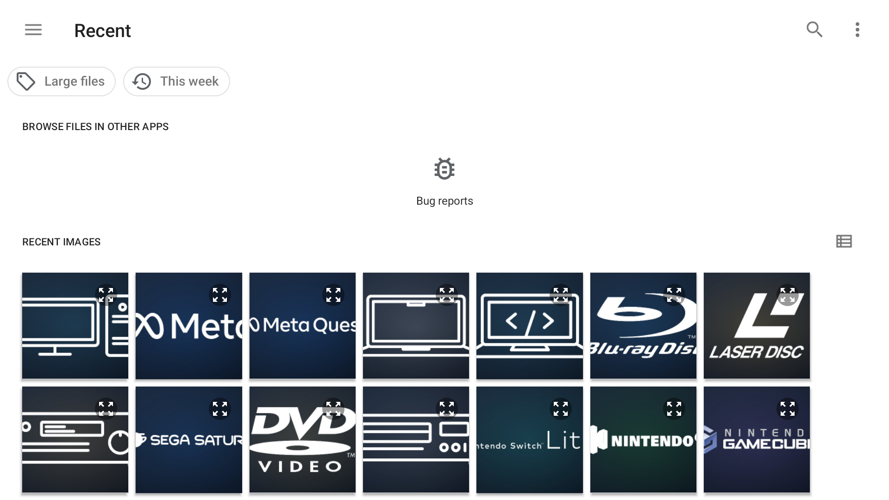

# HD app and input icons

The `icons/` folder contains 32 PNG images at 1920x1080. Logos are centered, keep their proportions, and have no additional text captions. Dark backgrounds keep the artwork legible inside wide launcher tiles.

## Install on the TV

The regular installer installs both the APK and the icon pack:

```bash
python3 scripts/install.py --serial YOUR_TV_IP:5555
```

To copy only the icons from this repository:

```bash
python3 scripts/install_icons.py --serial YOUR_TV_IP:5555
```

Images are copied to `/sdcard/Pictures/Icons`. The installer scans them and clears Android's pending-media flag so app image pickers can see them. Close and reopen an already-open picker after installation.

Each release also includes `fire-tv-ui-icons-VERSION.zip`. Extract its `Icons` directory into the TV's shared Pictures folder. The APK also bundles these images. Open Settings > Updates to grant icon storage access if needed and add missing files. Package replacement performs the same missing-only recovery when access already exists. Existing files are never overwritten by this native recovery. Use the script above to index files copied manually with ADB.

## Choose an icon

In Fire TV UI, long press the app or input tile you want to change. Choose **Change Icon**, then choose the logo in **Select Image**. The selected image belongs to that tile; replacing the source file does not replace an image the launcher has already copied. Select the updated image again to update an existing tile.

In LTvLauncher, long press an app, choose **Set Custom Banner**, and select the image through its gallery picker. The same shared images are available to both apps. LTvLauncher's built-in input panel does not offer the same custom-image control as its app banners.

## Optional built-in styles

Theme and wallpaper > Icon pack also offers Clean line and Muted solid. These use installed app artwork with an optional frame or subdued plate, independent of the 32 downloadable input images. Original and external packs remain available, and existing custom artwork stays selected. See [configuration](configuration.md#icon-styles).

## On-TV pickers

<table>
  <tr>
    <td><br>Fire TV UI</td>
    <td><br>Input tiles</td>
    <td><br>LTvLauncher picker</td>
  </tr>
</table>

## Included icons

| Category | Icons |
| --- | --- |
| Nintendo | NES, SNES, Nintendo 64, GameCube, Wii, Wii U, Switch, Switch 2, Switch Lite |
| Sega | Genesis, Master System, Dreamcast, Saturn |
| PlayStation | PlayStation 1, PlayStation 2, PlayStation 3, PlayStation 4, PlayStation 5 |
| Xbox | Xbox, Xbox 360, Xbox One, Xbox Series X |
| Media | DVD, VCR, Blu-ray, LaserDisc, Stereo Receiver |
| VR | Meta VR, Meta Quest |
| Computers | MacBook, Laptop, PC |

## Sources and regeneration

[The catalog](../icons/catalog.json) records each source URL and source SHA-256. [The notice](../icons/NOTICE.txt) credits logo sources and their owners. Product names and logos belong to their respective owners.

`source_sha256` identifies the exact bundled SVG bytes at `source`: the retained upstream file when `source_url` is present, or the original locally authored vector otherwise. Keep those source files unchanged. Rendering adjustments belong in the renderer, and the generated PNGs have separate hashes in the bundled icon manifest.

To render the bundled vector sources again, install Pillow and librsvg's `rsvg-convert`, then run:

```bash
python3 scripts/build_icons.py
```

These rendering tools are optional and are not required to install or build the application with the existing PNGs.
