# Screenshots

## Fire TV UI 1.4.1, code 40

Current physical Fire OS output from the exact signed `ca1b8b5a` release candidate. Live TV is visible beside OwnTV on the first page. Opening it reached the native GuideActivity; the guide frame shows schedules loading and does not establish channel playback. Back and injected Home returned to Main. A hardware remote Home check remains separate.

<table>
<tr>
<td> First-page Live TV</td>
<td>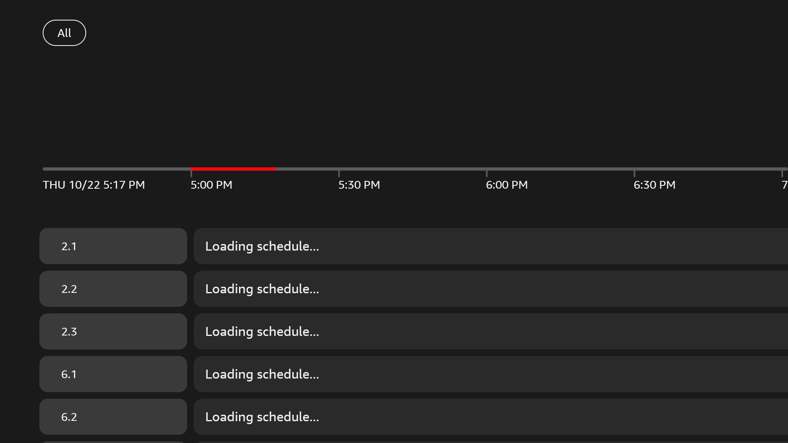 Native guide</td>
<td>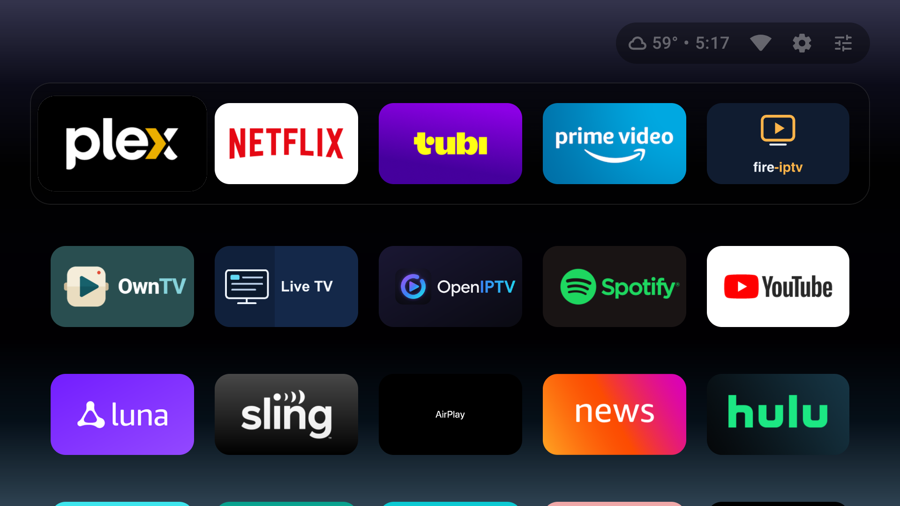 Back and Home</td>
</tr>
</table>

All 46 current portable UI preferences, nine OS values and both external backup/import files were preserved. The live settings guard and VPN remained active. The comparison used the fresh current layout after the deliberate Live TV placement change, rather than restoring its old position.

## Preliminary 1.4.1 code 39 helper verification

Earlier physical Fire OS output from preliminary code 39, exact signed `153da5a2`. The final release is code 40; these captures establish the unchanged helper-check interface and are not final-build screenshots. The helper row verifies the Android app version separately from its repository tag and disables replacement for the already installed version. The launcher capture is scrolled to its native TV tile row. The OwnTV capture was taken before Check for updates and correctly says not checked; it is not a current-version claim. A separate completed native check verified OwnTV 5.2.1 against its published TV APK.

<table>
<tr>
<td>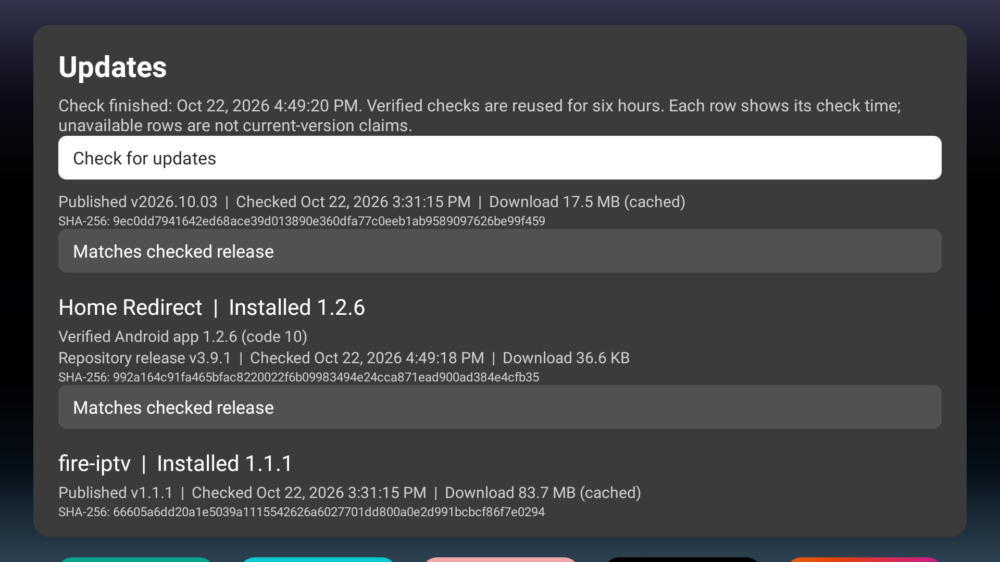 Verified helper version</td>
<td>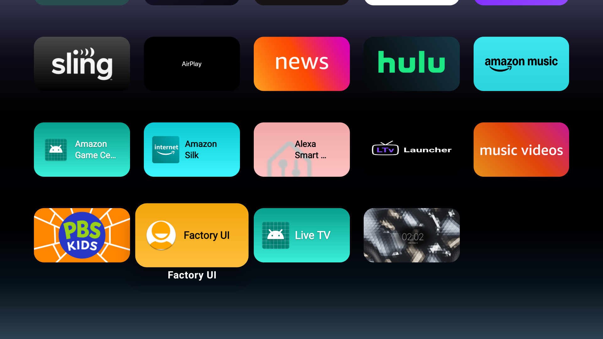 Native TV tiles</td>
<td>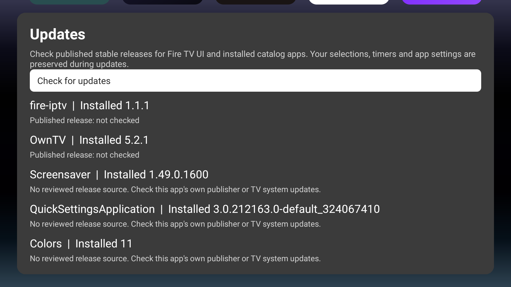 Before checking updates</td>
</tr>
</table>

## Previous Fire TV UI 1.4.0

These unretouched 1920x1080 captures show signed candidate `44057a7d` on physical Fire TV AFTDEC012E, Android 11/API 30. The repeated source build has all 631 app payload entries identical. The update check found the exact published OwnTV 5.2.1 TV APK and checksum. The native catalog installed accepted Prism Clock 1.0.0 through Android confirmation; installed APK bytes and signer were independently verified. Its picker row shows the bundled physical screenshot. The row capture shows the UI, while the separate settled Dream capture and binder record establish actual Prism rendering.

<table>
<tr>
<td>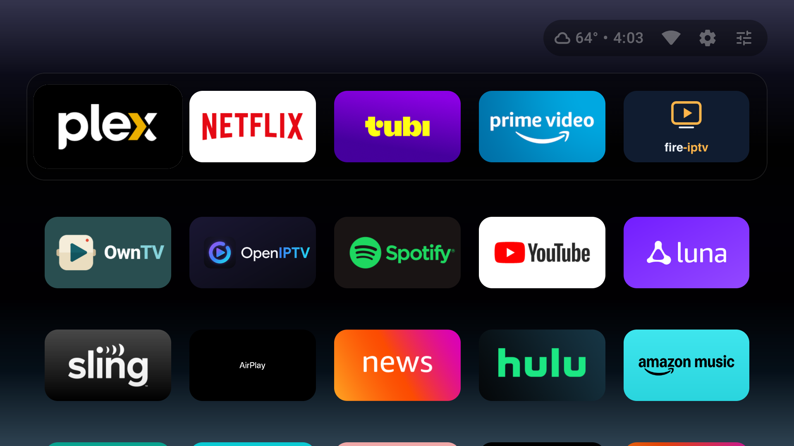 Home</td>
<td>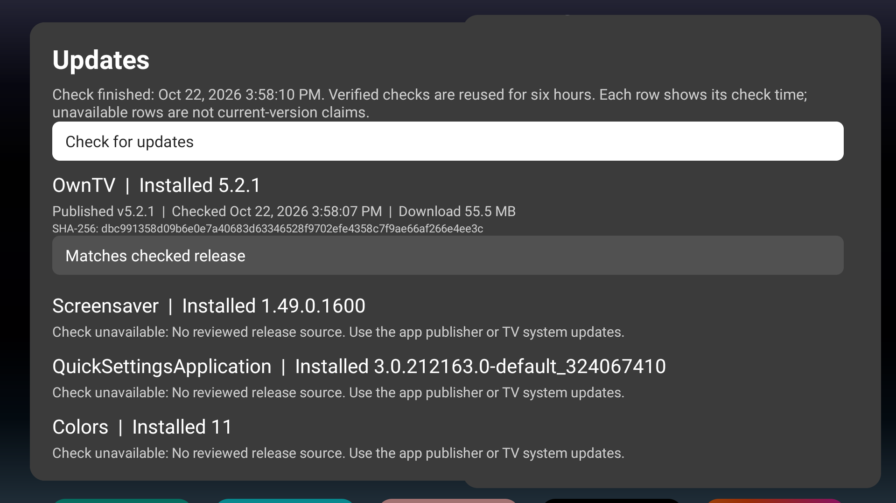 Updates</td>
<td>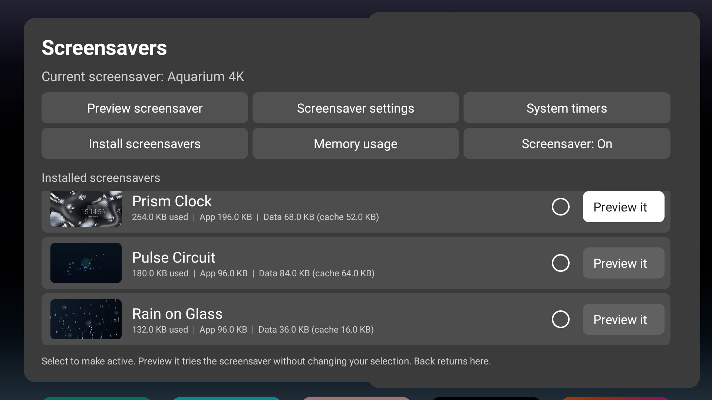 Prism picker</td>
</tr>
<tr>
<td>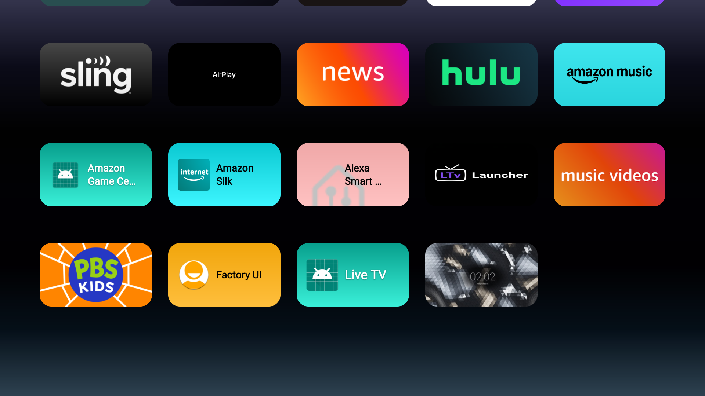 TV tiles</td>
<td>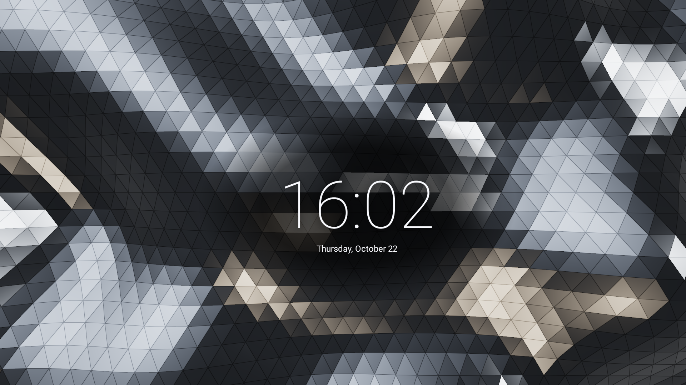 Prism Dream</td>
<td>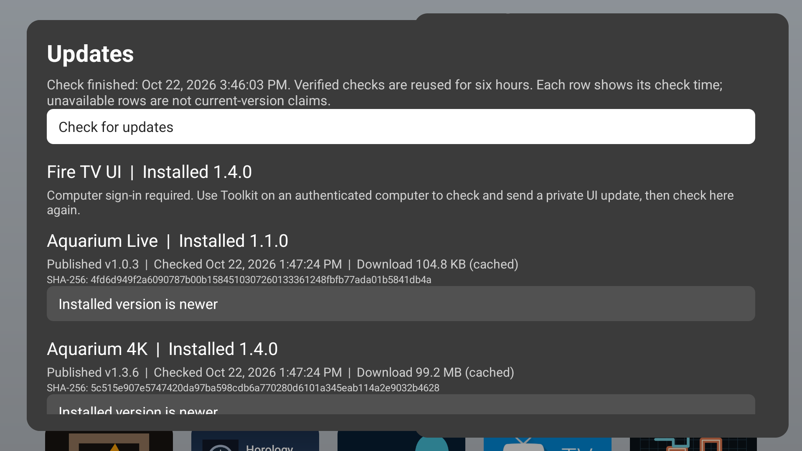 API 34 check</td>
</tr>
</table>

Back restored the selected Aquarium Dream. All 46 UI preferences and eight recorded OS settings read back unchanged; the external backup, live guard and VPN were preserved. Home from the settings route returned to the UI. A single Factory tile tap then opened actual Amazon Home for the physical-remote follow-up. That hardware Home check remains unverified; no shell-injected key is treated as equivalent proof. Unpublished emulator builds remain separate from downloadable stable catalog releases.

## Historical selected-idle candidate checks

These unretouched captures show the recovered Fire TV UI 1.3.3 candidate on Google TV API 34 at 1920x1080. Slot Vision is its separately released 1.0.0 APK. An activity preview does not establish a system DreamService binding.

<table>
<tr>
<td>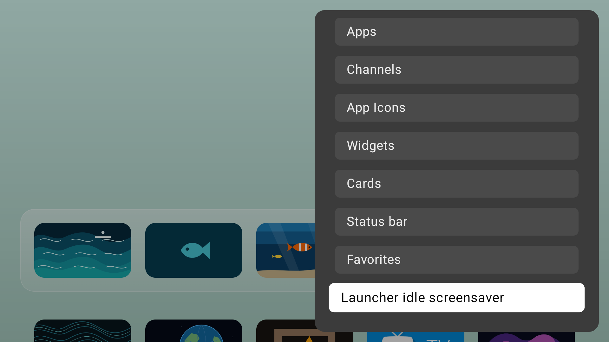 Idle</td>
<td>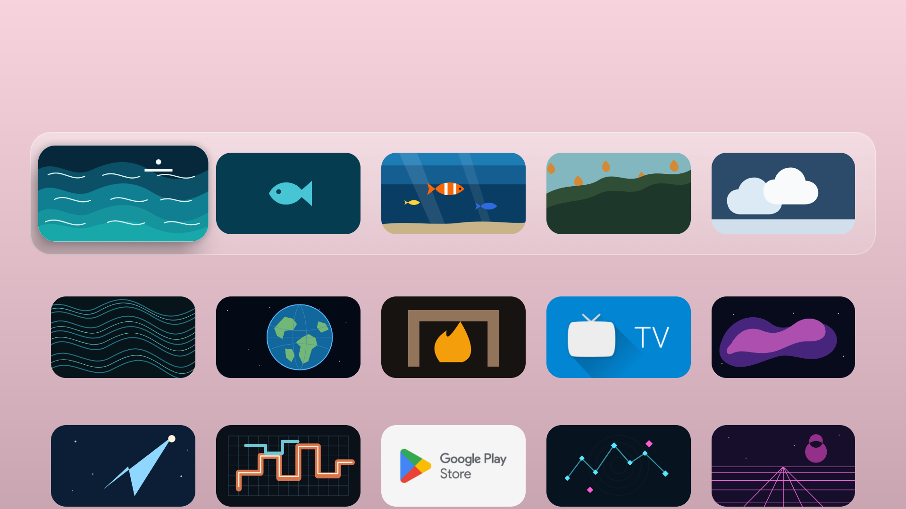 No app preview</td>
<td>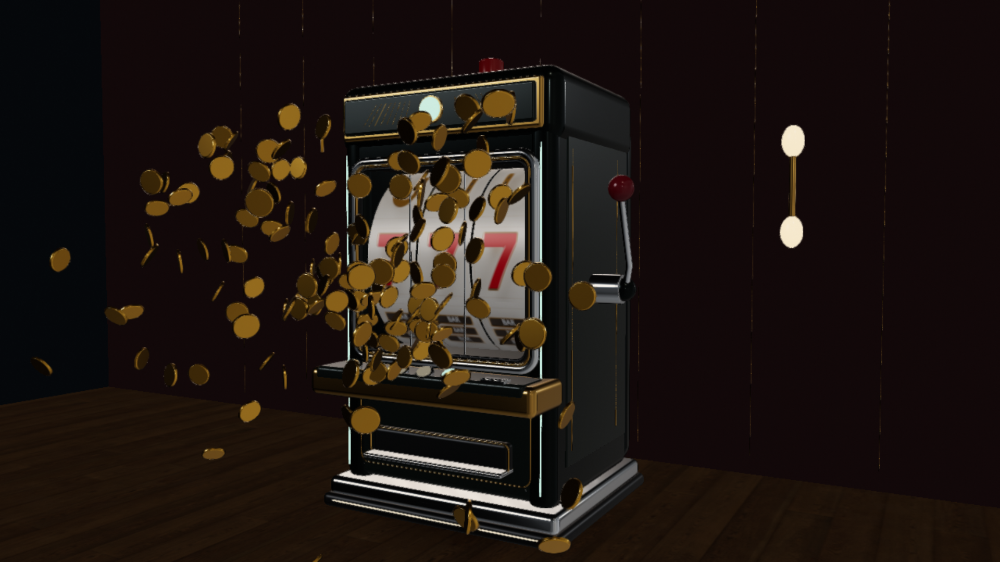 Slot preview</td>
</tr>
</table>

## Earlier launcher, catalog and preview captures

Captured on Fire TV hardware and documented TV emulators. Existing launcher and icon captures retain their documented versions. The corrected storage catalog shows 1.3.2 on physical Fire TV; the Rainforest catalog shows 1.3.1 and Advanced and Diagnostics show the 1.3.0 build on Google TV API 34 at 1920x1080.

<table>
  <tr>
    <td> Icons</td>
    <td> Input icon</td>
    <td> App menu</td>
  </tr>
  <tr>
    <td> Home</td>
    <td> Settings</td>
    <td> Savers</td>
  </tr>
  <tr>
    <td> Theme</td>
    <td> Old layout</td>
    <td> Controls</td>
  </tr>
  <tr>
    <td> Backups</td>
    <td> About</td>
    <td> Help</td>
  </tr>
  <tr>
    <td> Timers</td>
    <td> Memory</td>
    <td> Guard</td>
  </tr>
  <tr>
    <td>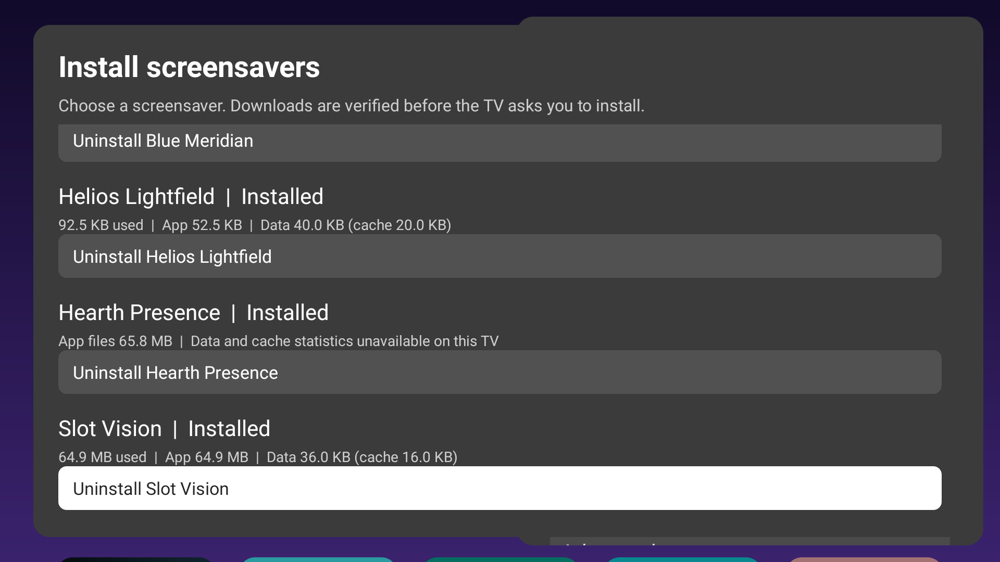 Storage</td>
    <td>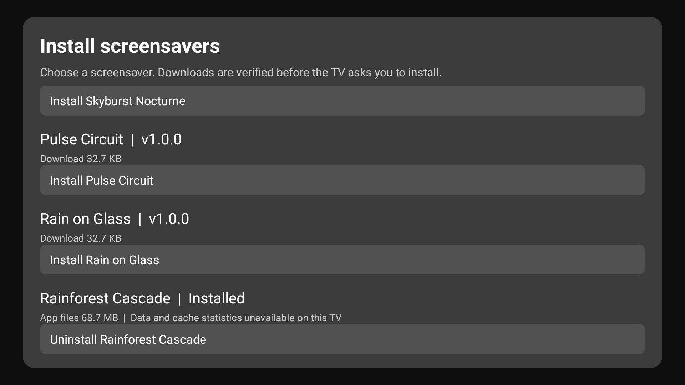 Catalog</td>
    <td> Backup</td>
  </tr>
  <tr>
    <td> Aqua</td>
    <td> Motion</td>
    <td> More savers</td>
  </tr>
  <tr>
    <td> Tools</td>
    <td> Report</td>
    <td> Details</td>
  </tr>
</table>

## Existing catalog previews

Earlier catalog images and their release provenance remain recorded in [screensaver previews](screensaver-previews.md). Listing an existing stable release is not a claim that its visual design has received new acceptance.
