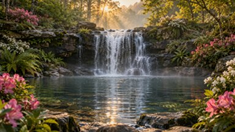

# Screenshots

## Current launcher idle checks

These unretouched captures show the recovered Fire TV UI 1.3.3 candidate on Google TV API 34 at 1920x1080. Slot Vision is its separately released 1.0.0 APK. An activity preview does not establish a system DreamService binding.

<table>
<tr>
<td> Appearance</td>
<td> Unsupported preview stays in the launcher</td>
<td> Selected Slot Vision preview</td>
</tr>
</table>

## Earlier launcher, catalog and preview captures

Captured on Fire TV hardware and documented TV emulators. Existing launcher and icon captures retain their documented versions. The corrected storage catalog shows 1.3.2 on physical Fire TV; the Rainforest catalog shows 1.3.1 and Advanced and Diagnostics show the 1.3.0 build on Google TV API 34 at 1920x1080.

<table>
  <tr>
    <td> Icon picker</td>
    <td> Custom input icon</td>
    <td> App menu</td>
  </tr>
  <tr>
    <td> Home</td>
    <td> Settings</td>
    <td> TV screensaver</td>
  </tr>
  <tr>
    <td> Theme Mode</td>
    <td> Earlier Appearance</td>
    <td> Controls</td>
  </tr>
  <tr>
    <td> Backup/Restore</td>
    <td> About</td>
    <td> Help</td>
  </tr>
  <tr>
    <td> System timers</td>
    <td> Memory usage</td>
    <td> Startup and protection</td>
  </tr>
  <tr>
    <td> Verified storage catalog</td>
    <td> Rainforest catalog</td>
    <td> TV backups</td>
  </tr>
  <tr>
    <td> Aquarium 4K</td>
    <td> Aquarium animation</td>
    <td> More installed screensavers</td>
  </tr>
  <tr>
    <td> Advanced</td>
    <td> Diagnostics</td>
    <td> Diagnostic report</td>
  </tr>
</table>

These are bundled previews of the animated screensavers available in the on-TV catalog.

<table>
  <tr>
    <td> Perseid Passage</td>
    <td> Split-Flap Drift</td>
    <td> Canopy Drift</td>
  </tr>
  <tr>
    <td> Contour Flow</td>
    <td> Skyburst Nocturne</td>
    <td> Pulse Circuit</td>
  </tr>
  <tr>
    <td> Hearth Presence</td>
    <td> Slot Vision</td>
    <td> Rainforest Cascade</td>
  </tr>
</table>
