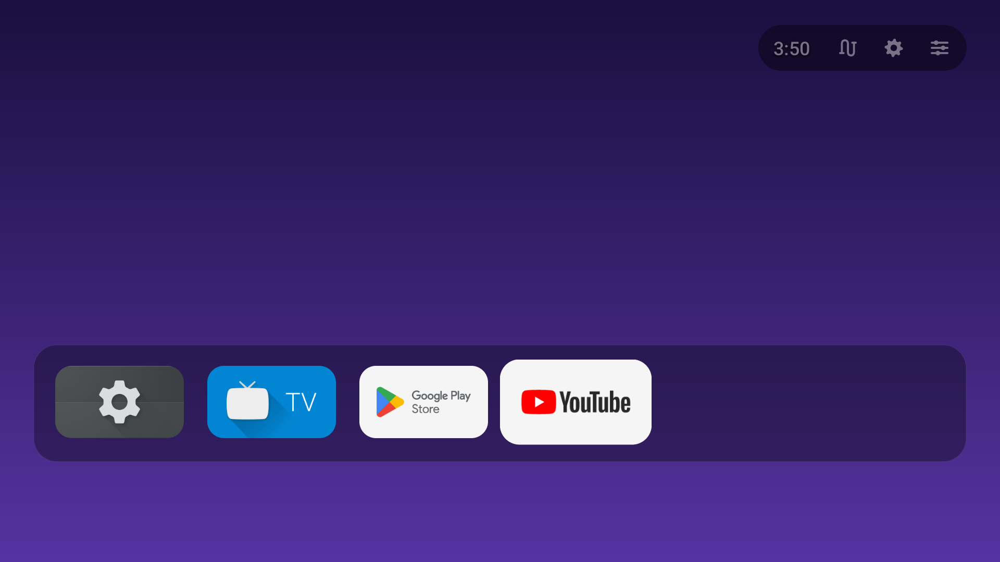
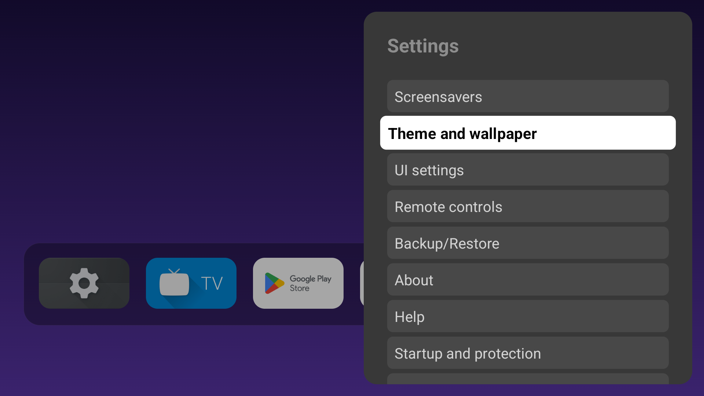
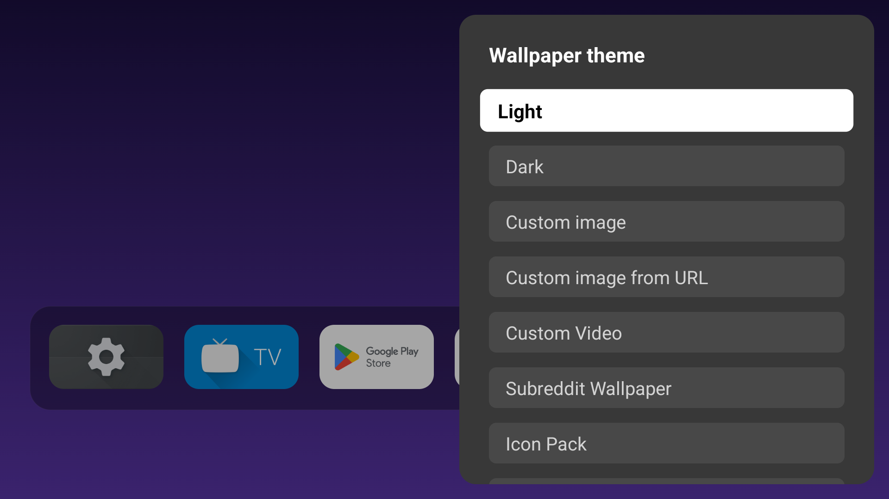
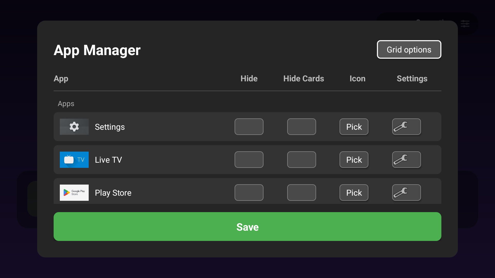
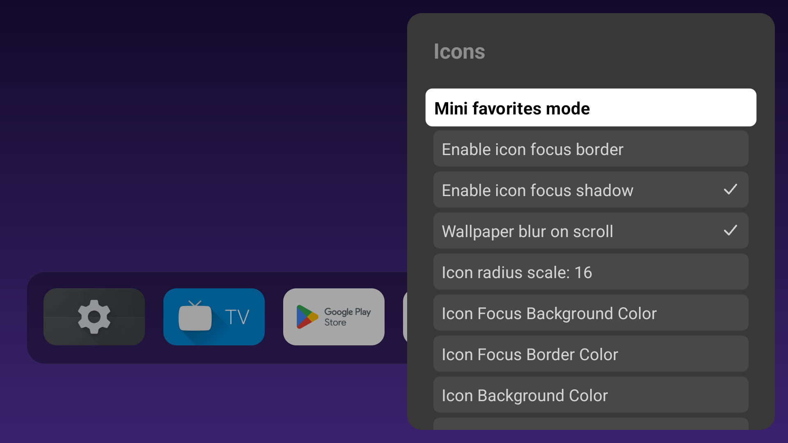
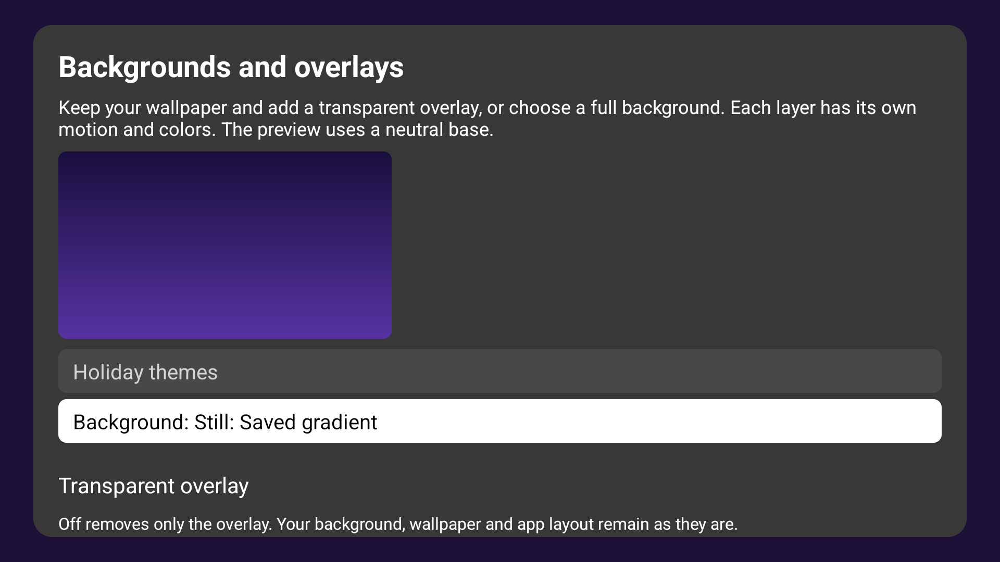

# Fire TV UI Source Preview

Version 2.0.0-alpha.2 restores the existing launcher presentation in the independently maintained native app. Stable [Fire TV UI 1.17.0](https://github.com/jeremykenedy/fire-tv-ui/releases/tag/v1.17.0) remains the latest stable release.

The preview installs separately as `com.jeremykenedy.firetv.ui.preview`. It keeps its own settings and does not replace the existing Home app or import production accounts.

## Included features

| Feature | What you can use |
| --- | --- |
| Home | Six apps per row, original default background and status pill, normal or compact dock, optional horizontal scrolling, saved app order and custom artwork. |
| App Manager | Hide apps or all cards from an app, select curated icons or personal artwork, and open Android app settings. |
| Icons and focus | Radius, shadow, focus style, independent speed and growth, color and opacity controls, and installed icon packs. |
| Cards and widgets | Shared order, global card size, per-channel timers, title options, local widget configuration and original widget colors. |
| Wallpaper | Light and Dark, personal images and silent video, downloaded HTTPS images, independent backgrounds and overlays, and recognizable holiday scenes. |
| Saved setups | Named local presentation snapshots with optional icon restoration and retained local media. |
| Backup | Selected-document export/import of supported preview settings. Account credentials and device controls remain local. |
| Device pages and Help | Capability-dependent system handoffs, remote setup, diagnostics and navigable Help. |

Provider cards depend on published content and authorized connections. This release does not claim complete production parity or universal exact-title playback.

## Installation and upgrade

Android 8.1 / API 27 is the declared minimum. Use ADB to install the APK from the [alpha.2 release](https://github.com/jeremykenedy/fire-tv-ui/releases/tag/v2.0.0-alpha.2), alongside its checksum and `release-artifact.json`.

```bash
shasum -a 256 -c fire-tv-ui-source-preview-2.0.0-alpha.2.apk.sha256
adb devices -l
adb -s YOUR_TV_SERIAL install -r fire-tv-ui-source-preview-2.0.0-alpha.2.apk
```

Open **Fire TV UI Source Preview** from the TV app list. Keep the stable Fire TV UI installed. The preview does not register as a replacement Home or accessibility service.

Alpha.2 uses versionCode 3 and the maintained preview certificate SHA-256 `c64ca640cab78e75fd52a6bb43bcbf145aa1b951f0c719b471df241bf70669c6`. Public alpha.1 uses the same identity. Android rejects an update from a preview signed with a different key; preserve that app's data and do not uninstall it to bypass the rejection.

## First use

Open **Settings > UI settings > Apps** for the App Manager. Use **Layout and focus** for grid dimensions, scrolling and focus style. **App Icons** contains mini dock, border, shadow, radius, colors and advanced motion controls.

Open **UI settings > Widgets** to enable widgets and configure their colors. New local widgets stay hidden until you select them. **Cards > Featured card setup** manages supported recommendation sources; **Channel Cards** and **Card timers** manage content and rotation. Cards remain in their saved slots while titles rotate.

Open **Theme and wallpaper** for personal media, colors, icon packs, **Backgrounds and overlays**, and **Saved setups**. The image URL action accepts HTTPS and keeps the previous wallpaper if download or validation fails. Subreddit wallpaper integration remains paused and its saved choice is retained.

Use **Backup/Restore > Manage TV backups** to export or import a supported preview document. Preview backups are not production migration tools. Account credentials and device settings stay local; personal source files and Android URI permissions are not embedded. Notes and reminders require their separate local export consent and an explicit export choice.

The Updates screen does not offer the legacy production APK as a preview update. Install this separate preview from the release assets.

## Data and rollback

Existing explicit preview layout, app order, focus and wallpaper choices are retained. An untouched default uses the restored original presentation. Saved weather city and units remain; the weather editor asks for an exact location when one is needed.

To stop using the preview, close it and open stable Fire TV UI or the TV's existing Home. Uninstalling the preview deletes its own data. Export supported settings before removal and retain personal media separately. No production downgrade is needed.

## Verification and limits

Final release verification is recorded in the [alpha.2 release notes](releases/v2.0.0-alpha.2.md). Native checks, physical installation and owner acceptance are distinct.

Production 1.x migration and Home takeover remain outside this preview. Physical voice, branded-button interception, CEC, receiver behavior and every provider-specific playback path require separate hardware evidence. External service additions remain deferred. General cleartext HTTP is disabled. Missing personal media remains an explicit unavailable state rather than being deleted.

## Screenshots

These unmodified alpha.2 captures show the running app on an API 34 TV emulator at 1920x1080 with stock apps and no personal accounts. The [capture record](../art/screenshots/source-alpha2-provenance.json) identifies the signed artifact, matching source inputs and image hashes.

<table>
  <tr>
    <td></td>
    <td></td>
    <td></td>
  </tr>
  <tr><td>Home</td><td>Settings</td><td>Wallpaper theme</td></tr>
  <tr>
    <td></td>
    <td></td>
    <td></td>
  </tr>
  <tr><td>App Manager</td><td>Icons</td><td>Backgrounds and overlays</td></tr>
</table>

The [stable gallery](screenshots.md) is separately labeled by release.

## Source and licenses

The build uses maintained `native/` Java/resources and the documented Android toolchain. It does not fetch, decode, patch or package AT4K. The former binary and patching tools remain only in Git history; applicable attribution and third-party notices are preserved.

Owned project material remains under the [MIT license](../LICENSE). Bundled artwork and other third-party material retain their notices, including the [native icon notice](../native/icons/NOTICE.txt). Do not infer one license for every historical asset from the repository's MIT license.

The [alpha release notes](https://github.com/jeremykenedy/fire-tv-ui/releases/tag/v2.0.0-alpha.2) record verification results and limitations. The [documentation index](index.md) retains the separately labeled 1.x guides.
