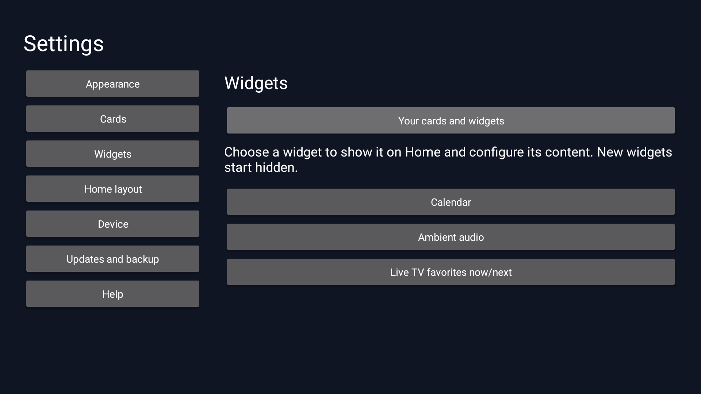

# Fire TV UI Source Preview

Version 2.0.0-alpha.2 is a separately installed preview of the new native interface. Stable [Fire TV UI 1.17.0](https://github.com/jeremykenedy/fire-tv-ui/releases/tag/v1.17.0) remains the latest stable release.

This early alpha is a separate application, not a production replacement. Its APK, checksum and `release-artifact.json` are distributed together through the alpha release.

## What is included

| Feature | Preview scope |
| --- | --- |
| Apps and inputs | App ordering, favorites, hide/show, folders, launcher-scoped locks, input names and per-tile artwork. |
| Cards and widgets | Shared order, visibility and card size; Android TV published recommendations, rotation controls and item/series hide/restore where verified identity is available. |
| Local widgets | Clock, world clocks, countdowns, timers, notes, reminders, selected photos, quick actions, breathing, sun/moon information and additional optional widgets. New widgets start hidden. |
| Tonight watchlist | Keep a local list, mark titles watched and look up exact Plex items when an authorized Plex connection is available. Availability and playback depend on the target service. |
| On This Day | Show dated historical events from Wikipedia with source and license attribution. Internet access is required. |
| Weather | Choose a supported U.S. location for National Weather Service forecasts. A saved city without exact coordinates requires a one-time location selection; the saved city and units are retained. |
| Appearance | Focus speed, growth, border/fill choices, curated and selected personal icons, supported icon packs, backgrounds, overlays and the included holiday scenes. |
| Saved setups | Named preview presentation snapshots with optional icon restoration and retained local images. Missing media produces an error without deleting the setup. |
| Portable backup | Explicit document export/import of reviewed preview settings. Credentials, device controls and lock secrets remain local; personal media is not embedded. Notes/reminders require their separate local export consent and an explicit choice for that export. |
| Device pages and Help | Screensaver administration, network/status pages, capability-dependent system-setting handoffs and original Help. Platform restrictions remain visible. |

These are alpha interfaces, not a statement of complete 1.x parity. A launcher lock controls actions inside this app; it does not secure Android or prevent another app from launching a target.

## Installation

The declared minimum is Android 8.1 / API 27. Sideloading requires ADB access. Runtime qualification is recorded separately from this minimum; no physical Fire TV, Google TV, voice, CEC or receiver acceptance is claimed for this alpha.

Download its APK, checksum and `release-artifact.json` from the [alpha release](https://github.com/jeremykenedy/fire-tv-ui/releases/tag/v2.0.0-alpha.2). Use the source-preview assets, not the stable 1.x installer or APK.

```bash
shasum -a 256 -c fire-tv-ui-source-preview-2.0.0-alpha.2.apk.sha256
adb devices -l
adb -s YOUR_TV_SERIAL install fire-tv-ui-source-preview-2.0.0-alpha.2.apk
```

Open **Fire TV UI Source Preview** from the TV's app list. Its package is `com.jeremykenedy.firetv.ui.preview`; stable Fire TV UI and its settings remain separate. Do not uninstall stable Fire TV UI or change Home routing to try this preview. The preview is not registered as a replacement Home or accessibility service.

The approved maintained preview certificate SHA-256 is `c64ca640cab78e75fd52a6bb43bcbf145aa1b951f0c719b471df241bf70669c6`. The release retains that existing preview identity; it does not require a new incompatible signer. A matching signer allows Android to consider an in-place preview update, but data continuity from earlier preview installations has not been qualified. Export the supported data you want to keep before updating.

For a preview signed with another key, Android will refuse an in-place update. Preserve any needed preview data before deciding whether to remove that app; there is no automatic migration across signers. Production 1.x data is not imported by this installation.

## First use

Open Settings and choose **Home layout > Apps grid** or **Your cards and widgets**. New local widgets remain hidden until selected. Configure private content and selected files explicitly; permission denial or an unavailable document provider may prevent a feature from working.

Use **Appearance** for focus, backgrounds and icon packs. Long-press an app/input tile for its available actions. Use **Cards > Recommendation sources** to choose supported sources. Android TV recommendations depend on what installed apps publish and what the platform permits. Plex setup requires your own authorized connection. Opening an app does not prove exact-title playback, entitlement or access to a service's personal watch history.

Use **Updates and backup > Saved setups** for local presentation snapshots, or **Backup and import** for a selected portable document. A preview backup is not a production migration tool. Unsupported legacy formats are retained and rejected for application until their mapping is verified. Notes, reminders, photos, connection credentials and device controls have separate privacy and persistence boundaries; a saved appearance is not a household/account backup.

Preview updates remain separate from the stable production APK. Check the Updates screen for the available preview release and review its details before installing.

## Data and rollback

The alpha keeps its own app data. It does not open another package's private settings, copy production accounts or silently adopt a production Home configuration. Imports validate supported settings and preserve local credentials, lock secrets and device controls. Private notes/reminders are excluded from export by default; imported content does not grant future export permission or enable detail display.

To stop using the preview, close it and open the stable Fire TV UI or the TV's existing Home. No production downgrade is needed. Uninstalling the preview deletes its local data. Export the supported preview data you want to keep before removing it, and retain selected personal source files separately. Restoring a preview document does not restore Android URI grants or account credentials.

## Preview limits

- Production 1.x migration, Home takeover, Alexa/receiver/CEC behavior and full feature parity are not delivered by this preview.
- A separate package cannot read the existing production app's private data. Unsupported legacy setups/backups are not silently converted or reset.
- Public streaming-service personal history and exact playback are not universally available. Provider permissions, published data and authorized service connections determine available cards/actions.
- General cleartext HTTP is disabled. The included loopback exception does not establish support for arbitrary HTTP Plex/NAS servers.
- Personal media and sensitive widget content are not automatically portable. A missing source remains an explicit unavailable state.
- API 27 runtime coverage, physical-TV performance and visual acceptance remain qualification gates. Build success or an emulator result does not establish those results.
- Prior alpha native card checks passed, including D-pad custom-timer Save, ordering and item hide/restore. The tested Android TV provider has no series identity; Plex series behavior has separate coverage.
- Prior alpha migration interruption/recovery checks passed with an isolated synthetic fixture at three write boundaries. They do not qualify a production upgrade or recovery using a corrective build.
- Widget availability depends on source configuration, network access and platform support. Plex access requires an authorized connection, and a local watchlist does not synchronize viewing history with other services.

## Screenshots

These captures show the signed Source Preview 2.0.0-alpha.2 candidate on an Android TV API 34 emulator at 1920x1080. The candidate APK has SHA-256 `e2e6391f32c42ac08aafe8e02d7e6778c2592cd0e8a8b1892083d994998e76ed`. Home shows the default clock and stock apps with no TV listings access; the other captures show the native Settings and Widgets pages. No personal accounts or content were used. These images do not establish physical-TV behavior.

<table>
  <tr>
    <td><a href="../art/screenshots/source-alpha2-home-api34.png"></a></td>
    <td><a href="../art/screenshots/source-alpha2-settings-api34.png"></a></td>
    <td><a href="../art/screenshots/source-alpha2-widgets-api34.png"></a></td>
  </tr>
  <tr><td>Home</td><td>Settings</td><td>Widgets</td></tr>
</table>

The [stable gallery](screenshots.md) retains the separately labeled Fire TV UI 1.17.0 captures and earlier releases.

## Source and licenses

The preview and production candidate builds use the maintained `native/` Java and resources. Neither build fetches, decodes, patches or packages the inherited launcher. Historical attribution and applicable third-party notices remain.

Owned project material remains under the [MIT license](../LICENSE). Bundled artwork and other third-party material retain their notices, including the [native icon notice](../native/icons/NOTICE.txt). Do not infer one license for every historical asset from the repository's MIT license.

The [alpha release notes](https://github.com/jeremykenedy/fire-tv-ui/releases/tag/v2.0.0-alpha.2) record verification results and limitations. The [documentation index](index.md) retains the separately labeled 1.x guides.
